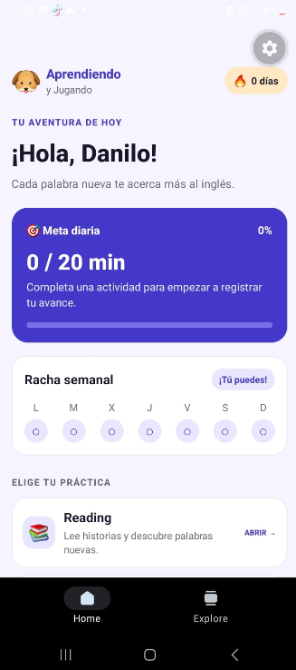
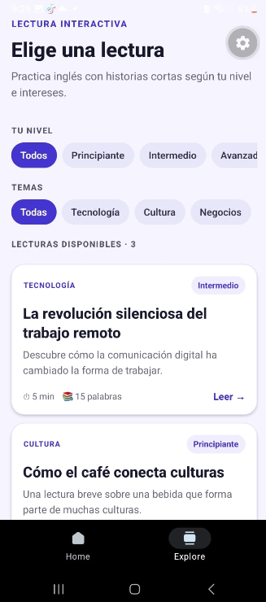
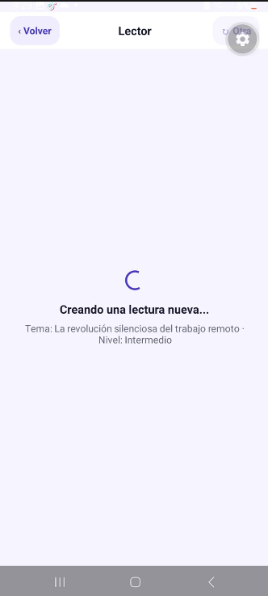
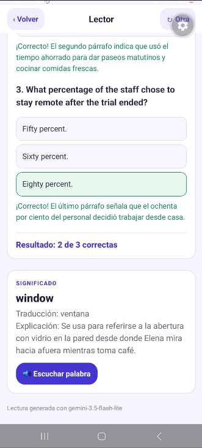

# Aprendiendo y Jugando

Una aplicación móvil para practicar inglés leyendo historias, escuchando su pronunciación y aprendiendo palabras dentro de su contexto.

## ¿Qué puedes hacer con la aplicación?

La idea es que puedas practicar inglés de una forma sencilla y a tu ritmo:

- Elegir un tema y un nivel de dificultad.
- Generar una lectura en inglés con ayuda de Gemini.
- Escuchar la lectura completa o una palabra.
- Tocar una palabra para consultar su significado en el contexto de la oración.
- Responder preguntas sobre la lectura y ver comentarios de las respuestas.
- Consultar tu meta diaria, racha e historial guardado en el dispositivo.

La aplicación está en desarrollo. Por ahora se ha probado en Android con Expo Go; todavía no está publicada en las tiendas.

## Capturas

Guarda las imágenes en `mobile/docs/` usando estos nombres:

| Inicio | Selección de lectura |
|---|---|
|  |  |

| Lector | Cuestionario |
|---|---|
|  |  |

## ¿Cómo funciona?

La aplicación móvil se comunica con un backend. El backend recibe la solicitud y consulta a Gemini para generar una lectura o ayudar con una traducción.

```text
Aplicación móvil → Backend FastAPI → Gemini
Aplicación móvil ← Backend FastAPI ← Gemini
```

La app no contiene la clave de Gemini. Esa clave se configura en el backend para evitar incluirla en el código que se instala en el teléfono.

## Tecnologías utilizadas

- **React Native:** permite crear la interfaz móvil.
- **Expo:** facilita el desarrollo y las pruebas en dispositivos Android y iPhone.
- **TypeScript:** ayuda a organizar los datos y detectar errores en el código.
- **Expo Router:** organiza las pantallas y la navegación.
- **React Context:** comparte datos del usuario entre distintas partes de la app.
- **AsyncStorage y SQLite:** guardan información localmente en el dispositivo.
- **Expo Speech:** reproduce el audio de las lecturas y palabras.
- **Python y FastAPI:** reciben las solicitudes de la aplicación y se comunican con Gemini.
- **Google Gemini API:** genera las lecturas y apoya las funciones de vocabulario y comprensión.

## Cómo está organizado el proyecto

El código está dividido en dos partes principales:

```text
APP_ENGLISH/
├── backend/
│   ├── main.py
│   ├── requirements.txt
│   └── .gitignore
└── mobile/
    ├── src/
    │   ├── app/
    │   │   ├── main/
    │   │   ├── index.tsx
    │   │   └── reader.tsx
    │   ├── components/
    │   ├── context/
    │   └── features/
    │       ├── onboarding/
    │       └── reading/
    │           ├── components/
    │           ├── services/
    │           └── types.ts
    └── package.json
```

- En `backend/` está la API hecha con FastAPI.
- En `mobile/src/app/` están las pantallas y rutas de la aplicación.
- En `features/onboarding/` está el flujo de bienvenida.
- En `features/reading/` está organizada la función de lectura: componentes, servicios y tipos de datos.
- En `services/` se encuentran tareas como llamar al backend, reproducir audio y guardar el historial.

Esta organización permite agregar funciones sin poner toda la lógica en una sola pantalla.

## Cómo ejecutar el proyecto durante el desarrollo

Para probar la app en un teléfono, necesitas iniciar el backend y Expo en dos terminales. La computadora y el teléfono deben poder comunicarse por la misma red.

### 1. Inicia el backend

En PowerShell:

```powershell
cd C:\MiPortafolio\APP_ENGLISH\backend
.\venv\Scripts\Activate.ps1
uvicorn main:app --reload --host 0.0.0.0 --port 8000
```

El backend necesita una clave de Gemini configurada localmente en `backend/.env`:

```env
GEMINI_API_KEY=tu_clave_aqui
```

No subas ese archivo a GitHub ni compartas su contenido.

### 2. Configura la dirección del backend

Cuando pruebes la app en un teléfono, `127.0.0.1` apunta al teléfono. Por eso, durante el desarrollo local, la app debe usar la dirección IP de la computadora.

La dirección se cambia en:

```text
mobile/src/features/reading/services/readingApi.ts
```

Configura `API_BASE_URL` con la IP local de tu computadora, por ejemplo:

```ts
const API_BASE_URL = 'http://192.168.1.10:8000';
```

Usa la IP que tenga tu computadora; el ejemplo puede ser diferente en tu red.

### 3. Inicia la aplicación móvil

Abre otra terminal:

```powershell
cd C:\MiPortafolio\APP_ENGLISH\mobile
npx expo start
```

Abre Expo Go en el teléfono y escanea el código QR que aparece en la terminal.

## Decisiones que tomé durante el desarrollo

- Separé la app móvil del backend para que la clave de Gemini permanezca en el servidor.
- Organicé las funciones por áreas, como `onboarding` y `reading`, para facilitar el mantenimiento.
- Separé el audio y las llamadas al backend de la interfaz de usuario.
- Mantengo el historial en el dispositivo. Por ahora no hay cuentas ni sincronización entre teléfonos.
- Me enfoqué en la experiencia móvil y probé la aplicación en Android con Expo Go.

## Avances y siguientes pasos

Hasta ahora, el proyecto incluye:

- [x] Flujo de bienvenida y captura del nombre.
- [x] Lecturas generadas mediante el backend y Gemini.
- [x] Consulta de vocabulario en contexto.
- [x] Audio para leer textos y palabras.
- [x] Cuestionario de comprensión.
- [x] Meta diaria, racha e historial local.

Me gustaría continuar con:

- [ ] Completar la práctica de escritura.
- [ ] Añadir más ejercicios de vocabulario.
- [ ] Publicar el backend para que no dependa de mi computadora.
- [ ] Sincronizar el progreso entre dispositivos.
- [ ] Preparar la aplicación para publicarla en las tiendas.

## Lo que aprendí

En este proyecto he practicado desarrollo móvil con React Native y Expo, organización de código con TypeScript, creación de una API con FastAPI e integración con Gemini. También aprendí a diagnosticar problemas de conexión entre el teléfono y la computadora y a probar la app en un dispositivo Android.

## Autor

**Abram**

Este proyecto sigue en desarrollo. Si tienes comentarios o sugerencias, serán bienvenidos.